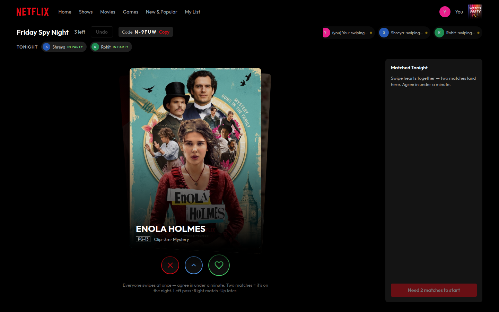

# Watch Together

Friends agree on a title in under a minute, then watch it on the same playhead. This is a Netflix-style hackathon demo of two things:

- **Title Match** — everyone swipes the same mood-filtered deck. Two Match votes put a title on **Matched Tonight**. The host starts from that rail. No group-chat vote.
- **Synced party playback** — play, pause, and seek stay together across browsers. Reactions, party chat, **Quiet (spoiler-safe)**, and one shared rating wrap the night.

It is a front-end plus a small party server. Short clips stand in for licensed streams. The app does not sign in to Netflix, and it does not need an account.



## Who it’s for

A group that opens Netflix and stalls on what to watch. This repo is the runnable demo of that decision, then the couch.

## Try it

**In the browser (no install):** [siddco17.github.io/watch-together](https://siddco17.github.io/watch-together/)

That hosted demo runs Title Match, bots, playback, Quiet, and wrap-up in one browser. Two-device sync needs the local server below.

**On your machine** (about ten minutes, including the walkthrough):

```bash
git clone https://github.com/siddco17/watch-together.git
cd watch-together
git lfs install
git lfs pull
npm install
npm start
```

Need [Node.js 18+](https://nodejs.org) and [Git LFS](https://git-lfs.com). The clips in `media/clips/` are LFS files. If a clip doesn’t load, the player says so — run `git lfs pull` and refresh.

Open [http://localhost:3000](http://localhost:3000).

**Presentation launchers** (start the server and open the browser):

- Mac: double-click **Start Demo.command**
- Windows: double-click **Start Demo.bat**
- Or: `npm run present`

Leave that window open. Close it to stop.

**Clickable opener:** double-click **Watch Together.html**. If the server is already running it jumps in. If not, start the demo first, then click **Open presentation**.

## Walkthrough

1. **Who's Watching?** → **Watch Party**
2. Pick a **Party mood** (Comfort / Thrills / New this week, and the other chips)
3. **Invite** one or two friends with a green dot (they swipe with you). Grey is offline (**Invited**). Red is **Busy**.
4. **Start Party**. Swipe pass / later / match. Bots help fill **Matched Tonight**.
5. **Start with…** → reactions, **Quiet · spoiler-safe**, then **End night**
6. Rate together. One party score. Leftovers stay for next time.

If you start alone, the rail tells you to invite someone online or share the party code. A title needs two Match votes.

## Two-browser sync

1. Host: **Start Party** and copy the code on the match header (`N-····`)
2. Guest, in another browser: **Watch Party** → paste the code → **Join**
3. Both see the same rail, playhead, chat, and rating. The guest shows up as **Guest** so the couch isn’t two people named You.

## What the pieces are

| Piece | Where it shows |
|---|---|
| Party mood | Chips before Start Party. The server builds the deck from titles tagged with that vibe. |
| Title Match | Parallel swipes. ≥2 Match votes land on Matched Tonight. |
| Quiet | On by default: reactions stay low and chat stays closed. Off opens party chat. |
| Party server | Express + Socket.io, in-memory rooms, invite codes. Vanilla HTML/CSS/JS in the browser. |

Full pitch, timed demo, and Q&A: **[PITCH.md](PITCH.md)**.

## Local media

Posters: `media/posters/` (Enola Holmes, Always Be My Maybe, The Adam Project, Red Notice, Raazi, Voicemails).  
Clips: `media/clips/` for those same titles. Stored with Git LFS.
